# Movement reference

This is the visual and command reference for the tester's 15 fixed movements. The GIFs below are the original repository assets, displayed at a consistent 160px width and grouped by use. Every source GIF is 1536 × 864 pixels. They are visual references, not calibrated motion specifications.

HIRO's behavior can depend on its starting pose, mechanical condition, power, and environment. The tester calls `neutralStance(hiro)` before every recognized command, including command `0`. Its selected values (`speed = 2`, `steps = 1`, and, where used, `repetitions = 2`) apply to this tester only—not every use of the upstream HIRO library.

For setup, start with [Getting started](GETTING_STARTED.md). For framing, output, and limits, read the [serial protocol](SERIAL_PROTOCOL.md).

## Visual gallery

### Neutral and emotes

| 0 — Neutral stance | 1 — Wave |
| --- | --- |
| 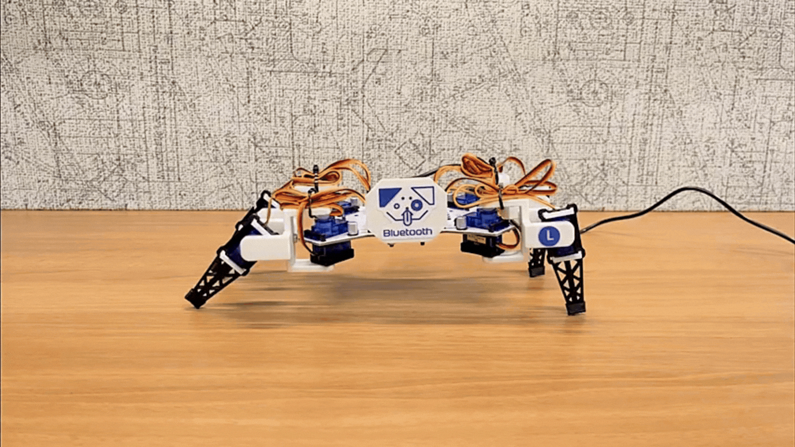 | 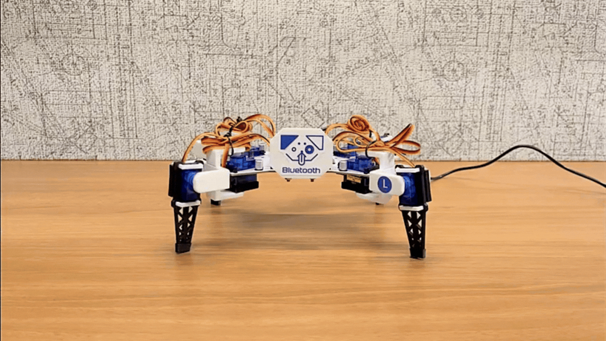 |

### Exercise and dance

| 2 — Worm | 3 — Stretch | 4 — Cabbage Patch | 5 — Cabbage Patch 2 | 6 — Push-ups |
| --- | --- | --- | --- | --- |
| 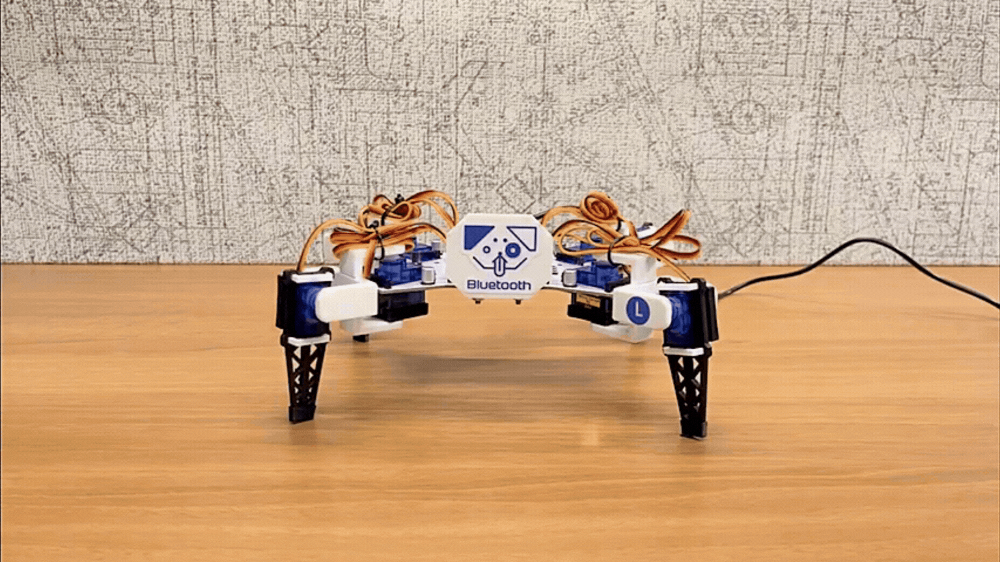 | 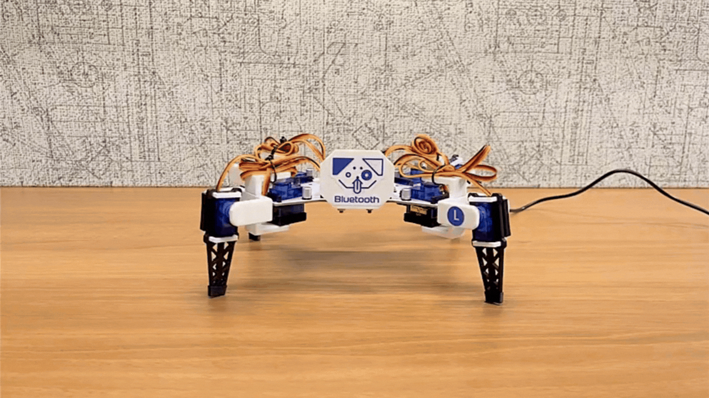 | 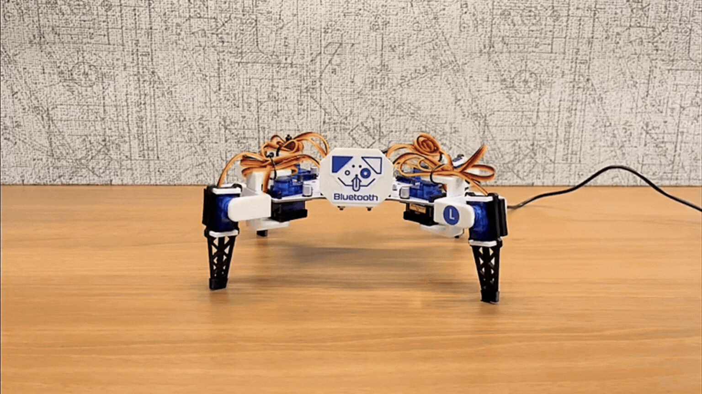 | 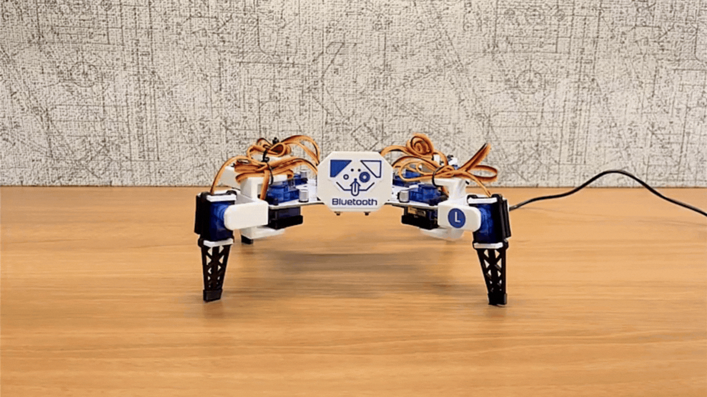 | 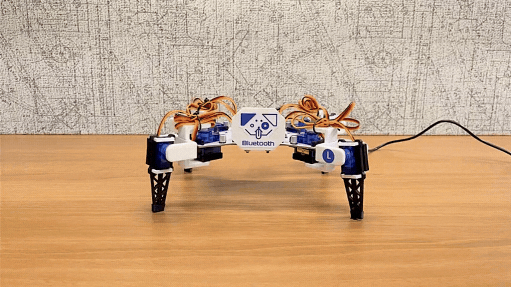 |

### Easy locomotion

| 7 — Forward | 8 — Backward | 9 — Clockwise | 10 — Counterclockwise |
| --- | --- | --- | --- |
| 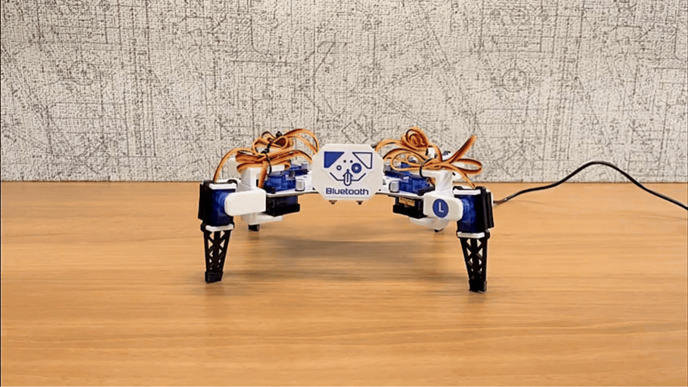 | 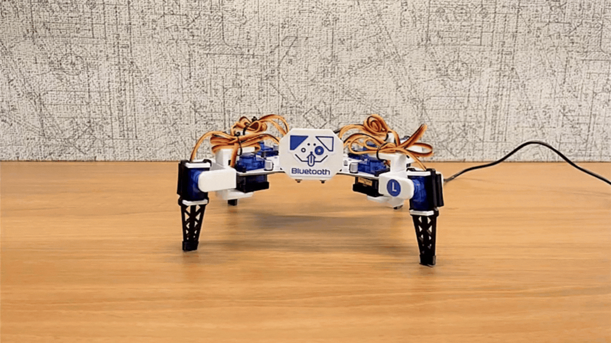 | 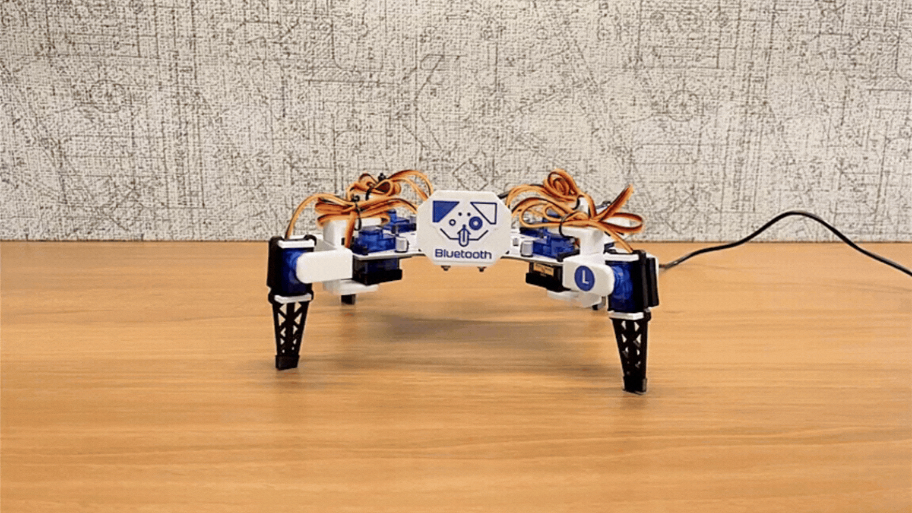 | 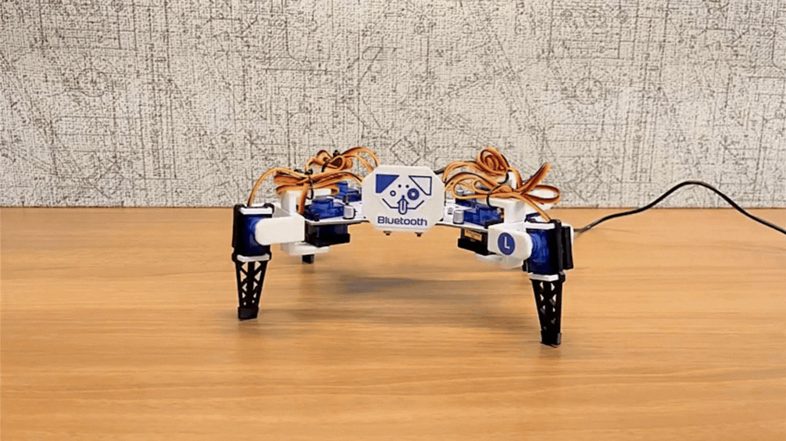 |

### Advanced locomotion

| 11 — Walk forward | 12 — Walk backward | 13 — Rotate clockwise | 14 — Rotate counterclockwise |
| --- | --- | --- | --- |
|  | 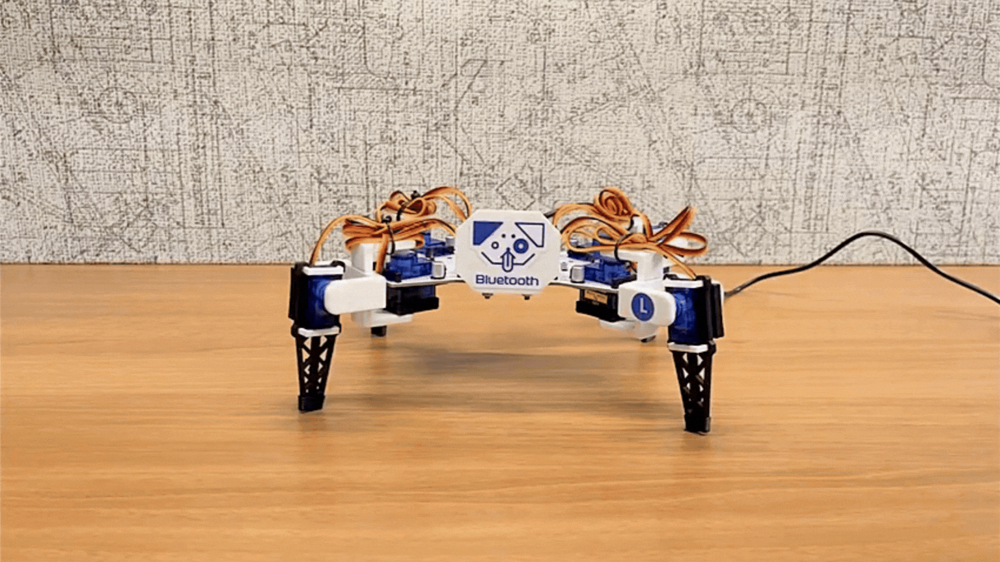 | 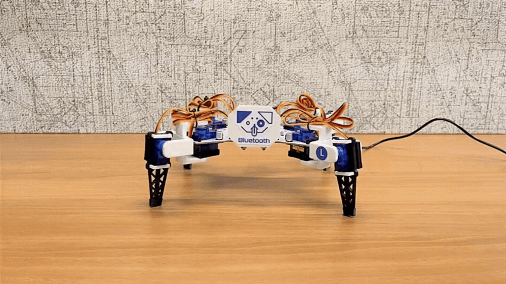 | 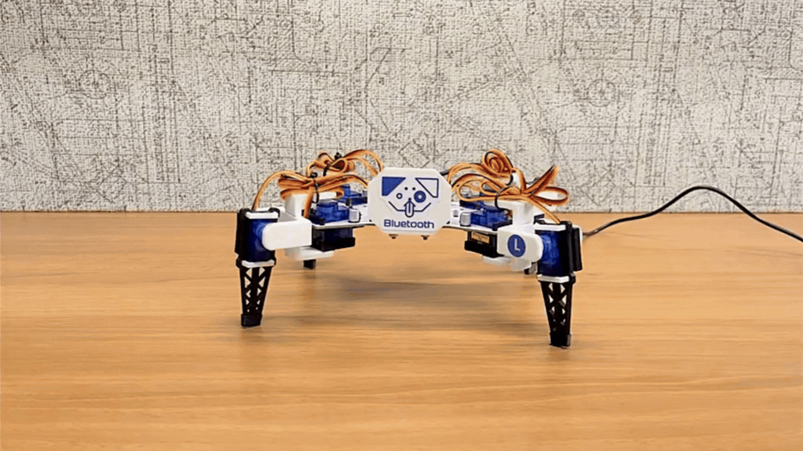 |

## Command details

| Command | Movement | HIRO library function | Tester-specific observation |
| ---: | --- | --- | --- |
| 0 | Neutral stance | `neutralStance(hiro)` | Establishes the tester's neutral pose. |
| 1 | Wave | `wave(hiro)` | Library wave emote. |
| 2 | Side-to-side worm | `sideToSideWorm(hiro, TEST_SPEED)` | Tester uses speed `2`. |
| 3 | Side-to-side stretch | `sideToSideStretch(hiro, TEST_SPEED)` | Tester uses speed `2`. |
| 4 | Cabbage Patch | `cabbagePatch(hiro, TEST_SPEED, TEST_REPETITIONS)` | Tester uses speed `2` and two repetitions. |
| 5 | Cabbage Patch 2 | `cabbagePatch2(hiro, TEST_SPEED, TEST_REPETITIONS)` | Tester uses speed `2` and two repetitions. |
| 6 | Push-ups | `pushUps(hiro, TEST_SPEED, TEST_REPETITIONS)` | Tester uses speed `2` and two repetitions. |
| 7 | Easy forward | `easyForward(hiro, TEST_STEPS, TEST_SPEED)` | Tester uses one step at speed `2`. |
| 8 | Easy backward | `easyBackward(hiro, TEST_STEPS, TEST_SPEED)` | Tester uses one step at speed `2`. |
| 9 | Easy clockwise | `easyClockwise(hiro, TEST_STEPS, TEST_SPEED)` | Tester uses one step at speed `2`. |
| 10 | Easy counterclockwise | `easyCounterClockwise(hiro, TEST_STEPS, TEST_SPEED)` | Tester uses one step at speed `2`. |
| 11 | Advanced walk forward | `walkForward(hiro, STANCE, STEP, WALK_STRIDE, TEST_SPEED, TRIM)` | Tester uses stance `0`, step `60`, stride `25`, speed `2`, trim `0`. |
| 12 | Advanced walk backward | `walkBackward(hiro, STANCE, STEP, WALK_STRIDE, TEST_SPEED, TRIM)` | Uses the same fixed walking values as command `11`. |
| 13 | Advanced rotate clockwise | `rotateClockwise(hiro, STANCE, STEP, ROTATE_STRIDE, TEST_SPEED)` | Tester uses stance `0`, step `60`, stride `20`, speed `2`. |
| 14 | Advanced rotate counterclockwise | `rotateCounterClockwise(hiro, STANCE, STEP, ROTATE_STRIDE, TEST_SPEED)` | Uses the same fixed rotation values as command `13`. |

## Related documentation

- [Getting started](GETTING_STARTED.md) — flash the tester and run the web GUI.
- [Serial protocol](SERIAL_PROTOCOL.md) — understand what the commands do and do not guarantee.
- [Documentation map](README.md) — choose another guide without searching the repository.
